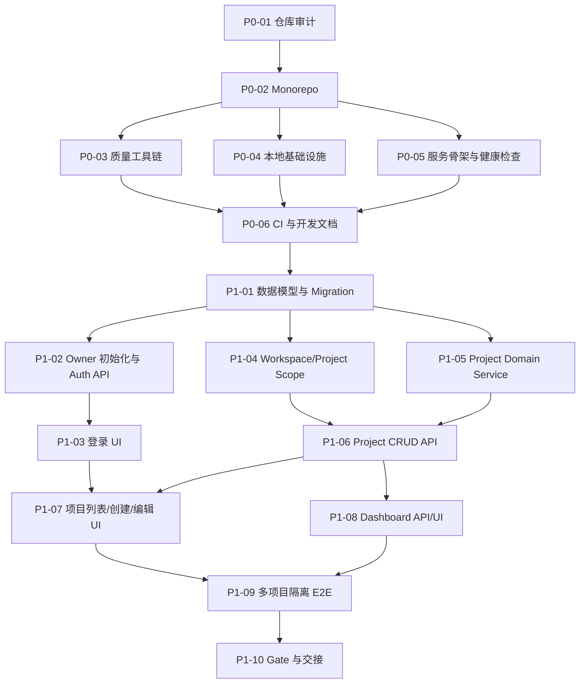

# Sprint Plan — Phase 0 → Phase 1

## 1. 排期基线

以单名主控工程负责人 + AI 编码 Agent 执行为假设。工期为工程日估算，不承诺日历交付日期；已有代码可复用时可缩短，遗留系统或环境问题会延长。

| 阶段 | 目标 | 任务数 | 估算工程日 | Gate |
|---|---|---:|---:|---|
| Phase 0 | 仓库、工具链、服务骨架、开发环境、CI | 6 | 3–5 | G0 工程基线可重复启动 |
| Phase 1 | 登录、Workspace 上下文、多项目管理、Dashboard、隔离测试 | 10 | 6–9 | G1 多项目个人工作台可验收 |
| 合计 | — | 16 | 9–14 | — |

实际 AI 编码墙钟时间取决于现有仓库成熟度、模型能力和人工审核节奏。此排期不包含 Agent Runtime、市场研究、Shopify、建站和运营模块。

## 2. 依赖关系

## 3. 并行策略

### 可有限并行
- P0-03、P0-04 可在 P0-02 完成后并行（分别修改质量配置与 Docker 文件）。
- P1-04、P1-05 可在 P1-01 完成后并行（前提是 P1-04 不修改 Prisma Schema，P1-05 不修改 Auth 中间件）。
- P1-08 的 Dashboard API 可在 P1-06 之后开发；前端部分可与 P1-07 并行，但必须由一个 Agent 统一维护页面布局和导航文件。

### 必须串行
- P0-01 必须先完成。
- Monorepo 根配置、依赖锁文件和脚本只能由一个 Agent 修改。
- 数据库 Schema 与 Migration 由 P1-01 单 Agent 负责。
- Auth Session、Cookie 和安全中间件由 P1-02/P1-04 按顺序负责。
- P1-09 只能在 API 和页面开发完成后执行。

## 4. Phase 0 Issue 清单

| ID | Issue | 依赖 | 估算 | 主要产物 |
|---|---|---|---:|---|
| P0-01 | Repository Audit & Baseline | 无 | 0.5–1 天 | `docs/sprints/phase-0/BASELINE_AUDIT.md` |
| P0-02 | Monorepo Bootstrap | P0-01 | 0.5–1 天 | Workspace、应用骨架、lockfile |
| P0-03 | Quality & Test Toolchain | P0-02 | 0.5–1 天 | lint/typecheck/test/format scripts |
| P0-04 | Local Infrastructure | P0-02 | 0.5 天 | Docker Compose、PG/Redis health |
| P0-05 | Service Skeleton & Health | P0-02,P0-03 | 0.5–1 天 | Workbench/API/Worker 可启动 |
| P0-06 | CI & Developer Runbook | P0-03,P0-04,P0-05 | 0.5–1 天 | CI、README、runbook |

## 5. Phase 1 Issue 清单

| ID | Issue | 依赖 | 估算 | 主要产物 |
|---|---|---|---:|---|
| P1-01 | Identity & Project Schema | P0 全部 | 0.5–1 天 | Prisma Schema + Migration |
| P1-02 | Owner Bootstrap & Auth API | P1-01 | 1 天 | 初始化命令、登录/登出/me |
| P1-03 | Auth UI & Protected Routes | P1-02 | 0.5–1 天 | 登录页、会话状态、路由保护 |
| P1-04 | Workspace Context & Scope Guard | P1-01,P1-02 | 0.5–1 天 | Workspace resolver、scope guard |
| P1-05 | Project Domain & State Rules | P1-01 | 0.5–1 天 | DTO、Service、状态机 |
| P1-06 | Project CRUD API | P1-04,P1-05 | 1 天 | 项目 API、OpenAPI、集成测试 |
| P1-07 | Project Workbench UI | P1-03,P1-06 | 1–1.5 天 | 项目列表/新建/详情/编辑 |
| P1-08 | Dashboard Summary | P1-06 | 0.5–1 天 | 真实统计 API + 首页 |
| P1-09 | Isolation & E2E Verification | P1-07,P1-08 | 1 天 | 跨项目隔离测试报告 |
| P1-10 | Phase 1 Gate & Handover | P1-09 | 0.5 天 | 验收报告、运行手册更新 |

## 6. Gate 标准

### G0：工程基线通过
- [ ] 安装依赖不报错，lockfile 一致。
- [ ] PostgreSQL、Redis 健康检查通过。
- [ ] Workbench、API、Worker 均能启动。
- [ ] `lint`、`typecheck`、`test`、`build` 通过。
- [ ] CI 在干净环境通过。
- [ ] README 能让新环境开发者按步骤启动项目。

### G1：个人工作台基础能力通过
- [ ] 可以通过初始化命令创建唯一所有者。
- [ ] 登录、登出、当前用户查询正常。
- [ ] 未登录访问受保护页面/API 会被拒绝或重定向。
- [ ] 可以创建、查看、更新、暂停、归档和恢复项目。
- [ ] 一个 Workspace 下至少创建 Project A、Project B。
- [ ] 列表、详情、更新接口均正确限定 Workspace。
- [ ] 使用另一用户/另一 Workspace 的项目 ID 请求时返回统一 404（避免枚举泄漏）。
- [ ] Dashboard 统计来自数据库实际查询。
- [ ] Unit、Integration、E2E 测试和 build 全部通过。
- [ ] 不存在伪造任务、销售、AI 执行数据的 UI。

## 7. Sprint 交付规则

每个 Issue 必须提交：
1. 变更文件列表；
2. 数据库 Migration（如有）；
3. API/类型/页面变更说明；
4. 验收命令及完整结果摘要；
5. 自动化测试覆盖范围；
6. 手工验证步骤；
7. 未完成事项和风险；
8. 是否影响后续 Issue。
